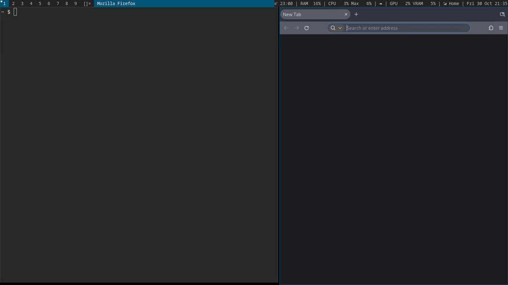
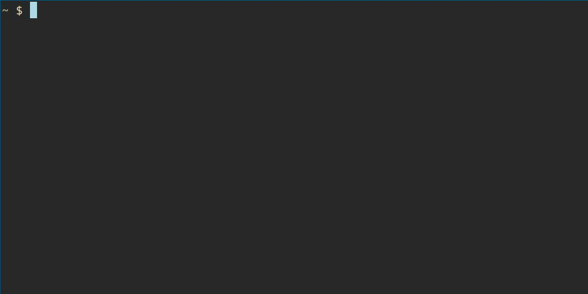

# focus

A website blocker for Linux.

During focus, only allowlisted domains are accessible. You can set schedules for focus and break periods. During breaks all domains are accessible as usual.





## Features

- Blocks at the DNS level, so it works in every browser and app.
- Follows a daily schedule, with an optional end date.
- `focus learn` finds what a page needs while you reload it.
- Pausing takes a typed sentence and a 10 minute wait (configurable).
- Config is owned by root, so changing it takes a deliberate step.

## Install

```sh
git clone https://github.com/sw1jari/focus
cd focus
sudo sh install.sh
```

| Needs | For |
|---|---|
| dnsmasq, nftables, systemd | The blocking itself |
| fzf | `focus learn` |
| NetworkManager or systemd-resolved | Finding your DNS servers, falls back to `/etc/resolv.conf` |
| doas or sudo | Commands that need root |

The installer:
- Copies `focus` to `/usr/local/bin`.
- Fills `/etc/focus` from the example files, without overwriting existing ones.
- Uses your own `allow.txt`, `schedule`, `config` or `until` instead, if they sit next to `install.sh`.
- Installs and starts the systemd timer.
- Turns off Firefox's built-in DNS over HTTPS with a policy.

Browsers with their own DNS over HTTPS skip focus. Turn it off in your browser (in Chrome, Brave or Edge: "Use secure DNS") and restart it.

If `focus blocked` shows nothing, add yourself to the `systemd-journal` group.

## Usage

| Command | What it does |
|---|---|
| `focus` | Shows whether blocking is on, any pause and the schedule |
| `focus learn` | Records what gets blocked while you reload a page, then lets you pick what to allow |
| `focus allow github.com` | Adds domains to the allowlist right away |
| `focus blocked "30 min ago"` | Lists blocked domains and how often they were asked for |
| `focus pause` | Type the sentence, wait out the countdown, then a pause (30 minutes by default) |
| `focus resume` | Ends a pause early |

In `focus learn` everything starts selected. Tab or space toggles, enter allows.

## Configuration

Everything lives in `/etc/focus`.

| File | Contents |
|---|---|
| `schedule` | One focus block per line, `HH:MM-HH:MM`, may cross midnight |
| `allow.txt` | One domain per line, subdomains included, `#` for comments |
| `config` | Pause sentence, countdown and pause length, see `config.example` |
| `until` | Optional end date like `2026-11-03 13:30`, focus turns itself off then |

## How it works

- A systemd timer runs `focus tick` every minute.
- During focus, a dnsmasq instance forwards only allowlisted domains and refuses the rest.
- An nftables rule sends all outgoing DNS on port 53 to that dnsmasq.
- During breaks both are removed.

## Limits

focus is a speed bump, not a lock. It doesn't stop:
- DNS over HTTPS in apps that bypass the system resolver.
- DNS over TLS on port 853.
- Hard coded IP addresses, or lookups a program already cached.
- A VPN with its own resolver.
- Containers and VMs with their own network, like Docker's default bridge.
- Anyone with root.

## License

MIT
